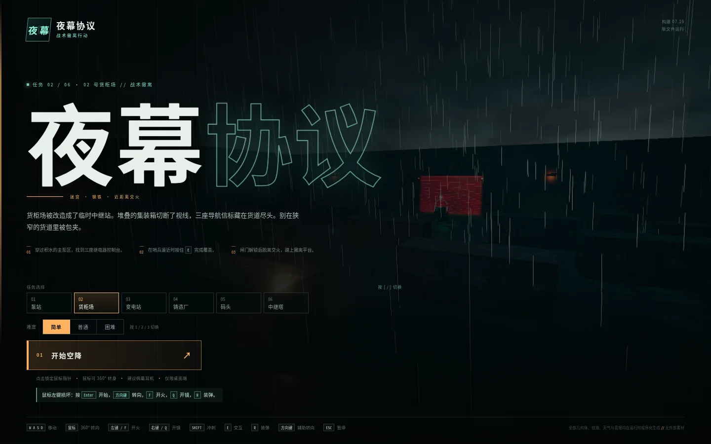
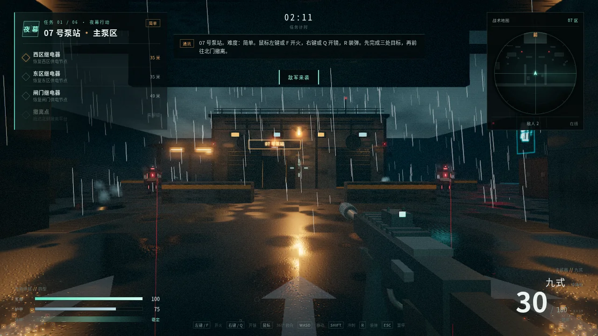
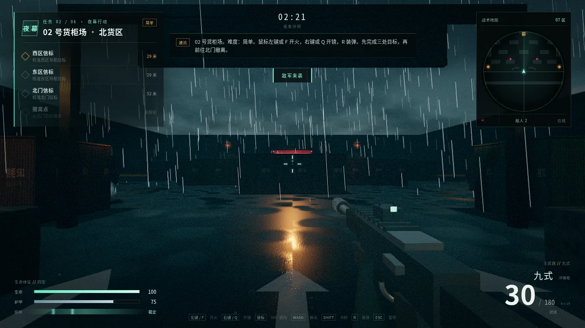
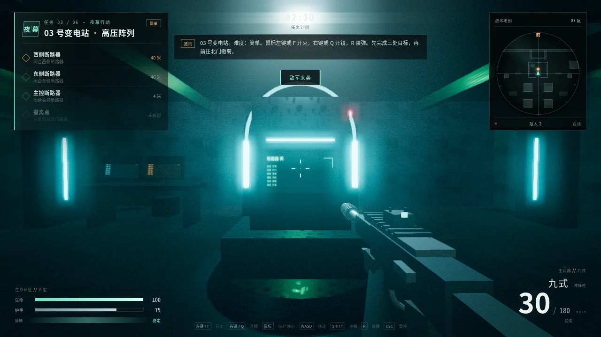
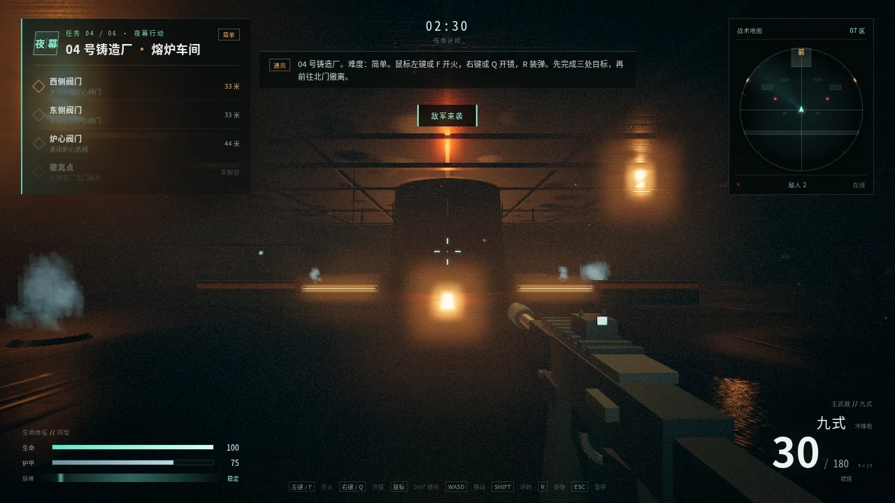
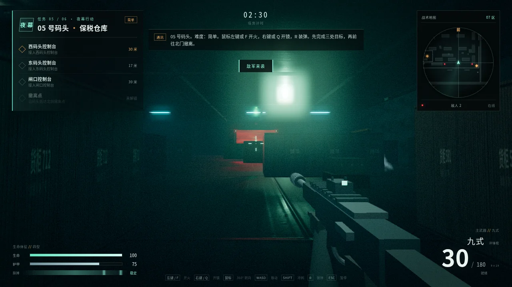
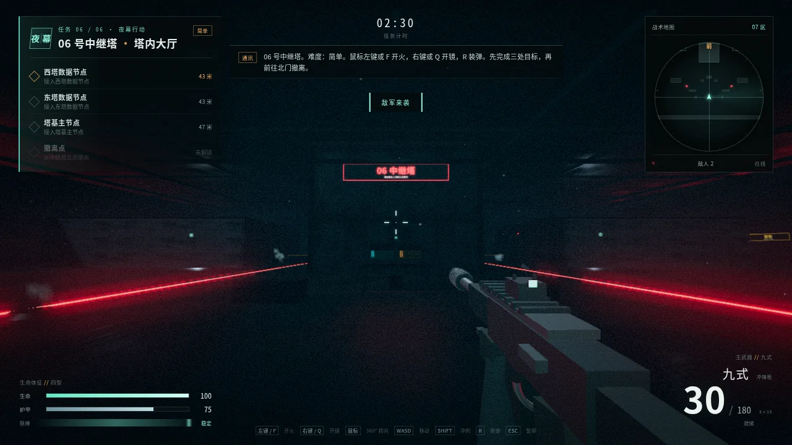
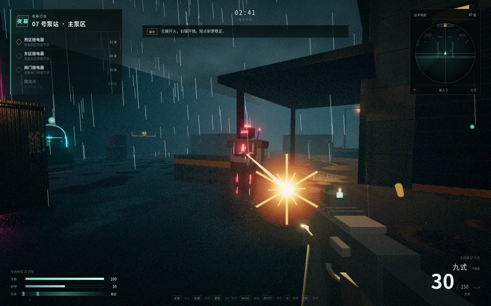

<div align="center">



# 夜幕协议 · Nightfall Protocol

**单文件 Three.js 第一人称射击游戏 · 六关战役 · 全程序化素材 · 离线可玩**

[](index.html)
[](https://threejs.org/)
[](https://www.khronos.org/webgl/)
[](LICENSE)

[在线试玩](https://yizhi-shi.github.io/nightfall-protocol/) · [下载 ZIP](https://github.com/yizhi-shi/nightfall-protocol/archive/refs/heads/main.zip) · [完整提示词](PROMPT.md)

</div>

---

## 简介

《夜幕协议》是一款发生在一场永不停歇的暴雨中的第一人称射击游戏。城市北区的泵站、货柜场、变电站、铸造厂、码头和中继塔相继失联。你需要在六个行动区里恢复三处关键节点，穿过哨兵与禁卫的封锁，从北门撤离。

整个游戏被打包进 **一个 739 KB 的 `index.html`**。没有 CDN、没有外部图片、没有模型文件、没有音频文件；纹理、模型、天气、光效和音效全部由代码在运行时生成。

- **六关独立布局**：每关有自己的空间结构、主题色、灯光、目标、敌人出生与巡逻配置。
- **双输入**：鼠标 360° 转身 + 左键开火；同时支持纯键盘 `F` 开火、方向键转向、`Enter` 开始/继续。
- **三档难度**：简单（默认）/ 普通 / 困难，影响敌人生命、伤害、精度、速度、玩家护甲、备弹、回血和目标交互时间。
- **完整射击反馈**：枪口焰、动态枪口光、曳光、抛壳、硝烟、后坐力、弹着火花、弹孔、受击方向指示和换弹动画。
- **单文件、可离线**：下载后用 Chrome / Edge 打开即可游玩。

## 在线试玩

> **https://yizhi-shi.github.io/nightfall-protocol/**

如果 GitHub Pages 暂时不可用，也可以下载仓库后直接打开 `index.html`。

## 六关战役

| 关卡 | 场景 | 空间特征 | 目标 |
| --- | --- | --- | --- |
| 01 | 07 号泵站 | 雨夜工业泵站、中央主楼、货柜与管廊 | 三座继电器 |
| 02 | 02 号货柜场 | 堆叠集装箱、窄货道、近距离交火 | 三座导航信标 |
| 03 | 03 号变电站 | 变压器阵列、高压塔、冷色电弧灯 | 三组断路器 |
| 04 | 04 号铸造厂 | 熔炉、蒸汽、吊梁、橙色火光 | 三座炉心阀门 |
| 05 | 05 号码头 | 运河、吊机、货柜、绿色航灯 | 三座码头控制台 |
| 06 | 06 号中继塔 | 风暴中心、中央通信塔、最终撤离 | 三座数据节点 |

开始界面可点击关卡按钮，或按 `[` / `]` 循环切换。每关通关后点击「下一关」继续；最后一关会进入「战役完成」结算。

## 截图

<div align="center">










</div>

<div align="center">

<br>
<sub>枪口焰、动态枪口光、曳光、抛壳与受击方向指示</sub>
</div>

## 操作

### 鼠标

| 输入 | 动作 |
| --- | --- |
| 移动鼠标 | 360° 转身、上下抬头 / 低头 |
| 鼠标左键 | 开火 |
| 鼠标右键 | 开镜 |

### 键盘备用方案

即使鼠标左键损坏，或完全不使用鼠标，也可以通关。

| 按键 | 动作 |
| --- | --- |
| `W` `A` `S` `D` | 移动 |
| `Shift` | 冲刺 |
| `Space` | 跳跃 |
| `C` | 蹲下 |
| `F` | 开火（按住连发） |
| `Q` | 开镜 |
| `R` | 装弹 |
| `E` | 长按交互 / 覆盖目标 |
| `Enter` | 开始 / 继续 / 下一关 / 失败后重开 |
| `Esc` | 暂停 / 继续 |
| `M` | 静音 |
| `↑` `↓` `←` `→` | 抬头 / 低头 / 左右转身 |
| `[` / `]` | 在开始界面切换关卡 |
| `1` / `2` / `3` | 选择简单 / 普通 / 困难 |

### 关卡与难度 URL 参数

```text
?level=1                 第一关
?level=3&difficulty=hard 第三关，困难
```

支持 `level=1..6`，`difficulty=easy|normal|hard`。直接刷新页面也会保留 URL 中的难度。

## 难度

| 难度 | 敌人生命 | 敌人伤害 | 玩家护甲 | 备弹 | 目标交互 |
| --- | --- | --- | --- | --- | --- |
| 简单（默认） | 74% | 60% | 75 | 180 | 1.9 秒 |
| 普通 | 100% | 100% | 50 | 150 | 2.35 秒 |
| 困难 | 132% | 135% | 25 | 120 | 2.9 秒 |

困难还会提高敌人精度、移动速度和回血延迟。

## 运行

### 直接运行

1. 下载或克隆仓库。
2. 双击 `index.html`，或拖进 Chrome / Edge。
3. 选择关卡和难度，点击「开始空降」，或按 `Enter`。

无需安装、无需服务器、无需联网。

### 本地 HTTP

```bash
python3 -m http.server 8080
# 打开 http://localhost:8080/
```

## 从源码构建

```bash
npm install
npm run build
```

构建脚本会把 `index.template.html`、`src/styles.css` 和 `src/main.js` 的 esbuild 产物合并为根目录的 `index.html`。

```text
index.template.html   HTML 结构与中文界面
src/main.js           游戏循环、输入、难度、关卡流程
src/levels.js         六关配置：主题、目标、敌人、灯光
src/world.js          程序化场景、碰撞、目标与撤离点
src/textures.js       Canvas PBR 纹理、法线、招牌
src/effects.js        枪口焰、曳光、弹壳、雨、火花
src/enemy.js          敌人模型、AI、射击
src/hud.js            HUD、小地图、结算
src/audio.js          Web Audio 合成音效
build.mjs             esbuild + 模板注入
index.html            构建产物，单文件可玩
```

## 技术要点

- **一个 HTML**：Three.js、addons、游戏代码、CSS、着色器全部内联。
- **零外部素材**：纹理由 Canvas 2D 生成；法线/粗糙度由高度图计算；模型由基础几何体组合；音效由 Web Audio 合成。
- **程序化 PBR**：沥青 1024、墙面/金属/货柜 512，配合环境反射、雾、体积光、Bloom、ACES、FXAA、锐化和颗粒。
- **固定光源预算**：静态阴影缓存、有限点光源、持久枪口光，避免动态光源导致着色器重编译。
- **自适应画质**：默认 DPR 上限 1.15，高画质 1.35；检测到软件渲染器时强制低画质。
- **碰撞体系**：旋转 AABB、玩家-敌人实体避让、枪械靠墙压低、子弹被最近实体阻挡。
- **关卡参数化**：`src/levels.js` 中的配置驱动主题、目标、敌人和灯光；`src/world.js` 提供泵站专用场景与五类通用关卡构建器。

## 测试记录

已用 Playwright + Chromium 在软件渲染环境下完成：

- 六关全部加载、进入、生成三处目标和八名敌人，无控制台错误与页面异常。
- 出生点、敌人出生点、目标点与碰撞体交叉检查通过。
- 货柜场完整流程：实际长按三处目标 → 开启北门 → 踏入撤离平台 → 胜利。
- 下一关跳转、最后一关「战役完成」、关卡选择、`[` / `]` 切换通过。
- 1280×720 与 1440×900 开始界面布局检查通过，无溢出。
- 鼠标 360° 转身、鼠标左键开火、F 键开火、Q 开镜、三档难度通过。
- 局域网 HTTP 页面与 ZIP 下载完整性通过。
- 页面无任何外部网络请求。

> 软件渲染环境下的低帧率不代表普通 GPU 浏览器表现；游戏会自动降低分辨率与后处理。

## 许可

本项目代码、程序化素材和截图采用 [MIT License](LICENSE)。

Three.js 与 esbuild 的第三方许可见 [THIRD_PARTY_NOTICES.md](THIRD_PARTY_NOTICES.md)。

## 完整提示词

本项目的完整可复用生成规格见 **[PROMPT.md](PROMPT.md)**。

---

<div align="center">
<sub>夜幕协议 · 雨还在下，但这一次你可以离开了。</sub>
</div>
